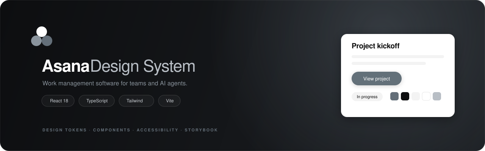
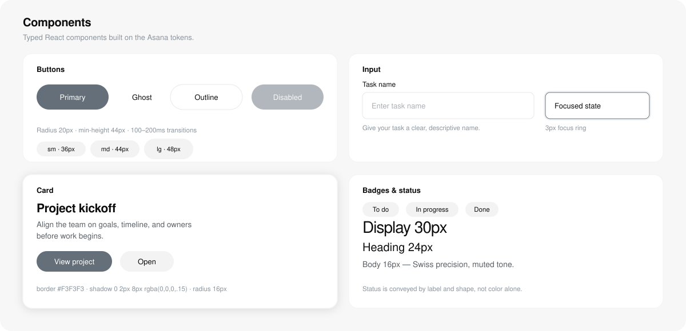
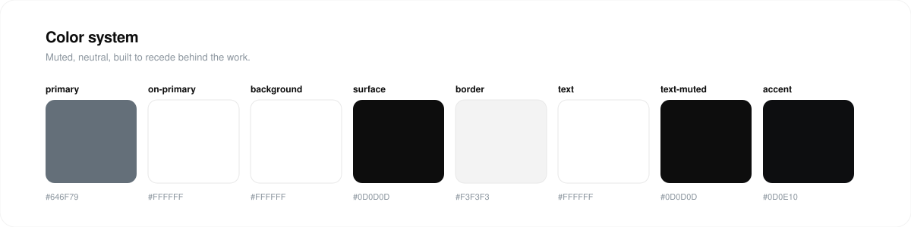
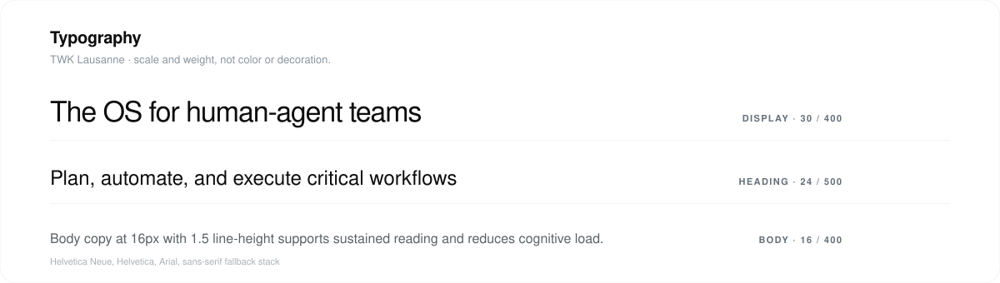

<p align="center">
  
</p>

# @asana/design-system

Production-ready React + TypeScript design system built on the [Asana design system](https://asana.com) tokens (version: alpha). Calm, muted, professional — designed for sustained, focused work.

<p align="center">
  <a href="https://github.com/TanimowoObaloluwaDavid/asana-design-system"></a>
  
  
  
  
</p>

<p align="center">
  
</p>

## What's included

| Artifact | Description |
|----------|-------------|
| `src/tokens.ts` | TypeScript design tokens — colors, typography, spacing, radius, shadows, motion, breakpoints |
| `src/theme.css` | CSS custom properties (`--asana-color-*`, `--asana-spacing-*`, etc.) for any stack |
| `src/components/Button` | Primary, ghost, outline, icon variants · sm/md/lg sizes · loading & disabled states |
| `src/components/Card` | Default & raised (surface color + elevated shadow) variants |
| `src/components/Input` | Label, helper text, focus states using Asana's primary color |
| `tailwind.config.js` | Tailwind v3 config mapping all Asana tokens to utilities |
| `tokens.json` | Machine-readable design tokens for Figma / Style Dictionary / build pipelines |
| Storybook stories | Variant/size/state matrix for every component |

## Quick start

```bash
# Install dependencies
npm install

# Start dev server (Vite)
npm run dev        # http://localhost:5173

# Type-check + build library to dist/
npm run build

# Storybook
npm run storybook  # http://localhost:6006
```

## Usage

### React components

```tsx
import { Button, Card, Input } from "@asana/design-system";

<Button variant="primary" size="md" loading>
  Saving…
</Button>

<Card variant="raised">…</Card>

<Input label="Task name" helper="Give your task a clear name." />
```

### CSS tokens (any stack)

```css
:root {
  --asana-color-primary: #646f79;
  --asana-color-surface: #0d0d0d;
  --asana-color-border: #f3f3f3;
  --asana-color-text-muted: #0d0d0d;
  --asana-spacing-6: 24px;
  --asana-radius-md: 8px;
  --asana-shadow-card: rgba(0, 0, 0, 0.15) 0px 2px 8px 0px;
  --asana-motion-duration-base: 200ms;
  --asana-motion-easing: ease-in-out;
}
```

### Tailwind

```js
// tailwind.config.js
module.exports = {
  theme: {
    extend: {
      colors: {
        primary: "#646f79",
        surface: "#0d0d0d",
        border: "#f3f3f3",
        "text-muted": "#0d0d0d",
        accent: "#0d0e10",
      },
      spacing: { 6: "24px", 12: "48px", 16: "64px" },
      borderRadius: { md: "8px", lg: "20px", xl: "64px" },
      boxShadow: { card: "rgba(0, 0, 0, 0.15) 0px 2px 8px 0px" },
      transitionDuration: { base: "200ms" },
    },
  },
};
```

Then use utilities: `bg-primary text-text-muted shadow-card rounded-md duration-base ease-in-out`.

## Design tokens

### Colors

<p align="center">
  
</p>

| Token | Value | Usage |
|-------|-------|-------|
| `primary` | `#646f79` | Interactive — buttons, links, active states |
| `on-primary` | `#ffffff` | Text on primary backgrounds |
| `background` | `#ffffff` | Canvas |
| `surface` | `#0d0d0d` | Secondary zones (cards, modals, sidebars) |
| `border` | `#f3f3f3` | Soft borders matching surface |
| `text` | `#ffffff` | Text on colored backgrounds |
| `text-muted` | `#0d0d0d` | Body copy — 18.5:1 vs white (WCAG AAA) |
| `accent` | `#0d0e10` | Secondary UI elements |

### Typography

<p align="center">
  
</p>

| Scale | Size | Weight | Line-height | Letter-spacing |
|-------|------|--------|-------------|----------------|
| `display` | 30px | 400 | 1.2 | -1.08px |
| `heading` | 24px | 500 | 1.2 | — |
| `body` | 16px | 400 | 1.5 | — |

Font family: `TWK Lausanne, Helvetica Neue, Helvetica, sans-serif`

### Spacing (8px base grid)

`4, 8, 12, 16, 20, 24, 32, 48, 64, 112` px

### Radius

`sm: 4px · md: 8px · lg: 20px · xl: 64px`

### Motion

`fast: 100ms · base: 200ms · slow: 300ms · easing: ease-in-out`

### Breakpoints

33 values from `1px` to `2000px` — see `src/tokens.ts` for the full list.

## Accessibility

- Touch targets ≥ 44×44px on all interactive elements
- Focus-visible outlines (2px, offset 2px) on buttons and inputs
- `text-muted` (#0d0d0d) on white = ~18.5:1 → WCAG AAA
- Motion capped at 300ms with `ease-in-out` for vestibular safety
- Status conveyed by label + shape, not color alone

> **Note:** The spec's `surface` token is `#0d0d0d` (near-black) per the YAML source, while the written rationale describes it as `#f3f3f3`. This build uses the structured token values as the source of truth.

## Project structure

```
asana-design-system/
├── package.json          # React 18 + Vite + Tailwind + TypeScript
├── tsconfig.json         # Strict TypeScript
├── vite.config.ts        # Dev server + library build (esm/umd)
├── tailwind.config.js    # Asana tokens → Tailwind utilities
├── postcss.config.js     # Tailwind + Autoprefixer
├── index.html            # Entry point
├── tokens.json           # Design tokens (JSON — Figma/dev handoff)
├── LICENSE               # MIT
├── README.md             # This file
├── assets/               # Banner, color, typography & component previews (SVG)
│   ├── banner.svg
│   ├── colors.svg
│   ├── components.svg
│   └── typography.svg
├── css/                  # Standalone CSS distribution (no build required)
│   ├── tokens.css
│   └── components.css
├── src/
│   ├── main.tsx          # React entry
│   ├── App.tsx           # Live demo page
│   ├── theme.css         # CSS custom properties
│   ├── tokens.ts         # TypeScript design tokens
│   └── components/
│       ├── index.ts      # Barrel exports
│       ├── Button/       # Button.tsx, Button.stories.tsx
│       ├── Card/         # Card.tsx, Card.stories.tsx
│       └── Input/        # Input.tsx, Input.stories.tsx
```

## Scripts

| Script | Purpose |
|--------|---------|
| `npm run dev` | Vite dev server with HMR |
| `npm run build` | Type-check + build library bundles to `dist/` |
| `npm run preview` | Preview production build |
| `npm run storybook` | Storybook dev server |
| `npm run build-storybook` | Build Storybook static site |

## License

MIT
